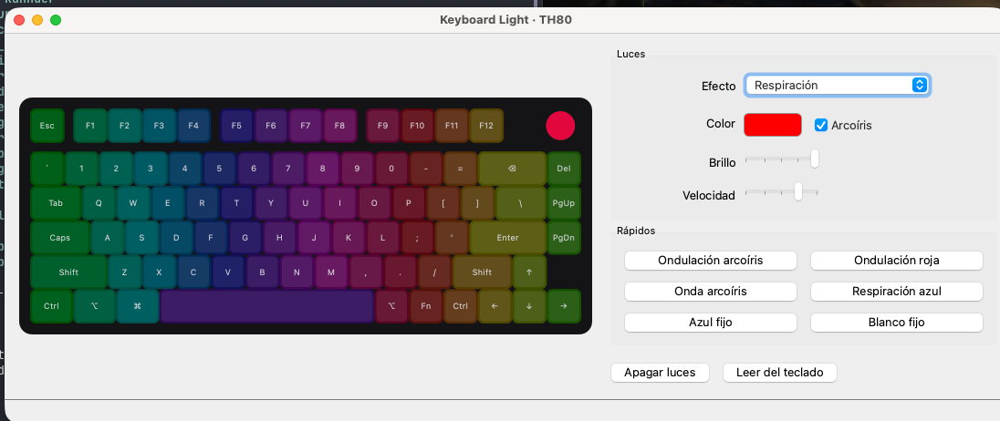

# kblinkboard

Control de las luces del teclado **Epomaker TH80** (USB `3151:4002`) en macOS
con Apple Silicon, sin el driver oficial de Epomaker ni Rosetta. Incluye una
app con ventana (PySide6) y una CLI (Typer).



## Por qué existe

- El driver oficial de Epomaker para Mac (v2.1.90) solo existe para Intel y
  pide instalar Rosetta.
- La versión web, [EPOMAKER Hub](https://hub.epomaker.com), solo reconoce el
  TH80 V2 y el TH80 V2 PRO, no el TH80 original.

Este proyecto habla directamente con el teclado por USB usando el protocolo HID
de ROYUAN (familia yc500), documentado por
[sharkfin](https://github.com/dniminenn/sharkfin/blob/master/docs/PROTOCOL.md).
Solo envía comandos de luces y de lectura; **nunca toca el firmware**.

## Requisitos

- macOS con Apple Silicon y [uv](https://docs.astral.sh/uv/).
- El teclado conectado **por cable USB**. Ni Bluetooth ni el receptor 2.4 GHz
  dan acceso a los ajustes.
- Permiso de **Monitorización de entrada** para tu terminal (Terminal, Ghostty,
  iTerm…): Ajustes del Sistema → Privacidad y seguridad → Monitorización de
  entrada. Después cierra la terminal y vuelve a abrirla.

```sh
uv sync --locked
```

Las versiones están fijadas: `pyproject.toml` pide versiones exactas
(`hidapi==0.15.0`, `pyside6-essentials==6.12.0`, `typer==0.27.3`), `uv.lock`
guarda también la versión y el hash de cada dependencia indirecta, y
`.python-version` fija Python 3.14.0. `--locked` hace que la instalación falle
si el lock no coincide con `pyproject.toml`, en vez de actualizarlo en silencio.

Python 3.15 todavía no sirve: `hidapi 0.15.0` no publica versión precompilada
para él. Y `hidapi` conviene no actualizarlo sin probar, porque el programa usa
una función interna suya para abrir el teclado en macOS.

## App con ventana

```sh
uv run kblinkboard-gui
```

- Al abrirse lee la configuración actual del teclado.
- **Efecto, color, arcoíris, brillo, velocidad y dirección.** Cada cambio se
  envía solo, 350 ms después de que dejes de mover el control, para no saturar
  el teclado.
- El color se elige con el **selector nativo de macOS**.
- **Vista previa animada** del TH80. En los efectos que reaccionan al teclear
  (Ondulación, Sombra de tecla), escribe o haz clic en las teclas dibujadas.
  Es una aproximación: el efecto real lo genera el firmware del teclado.
- **Efectos rápidos**: Ondulación arcoíris, Ondulación roja, Onda arcoíris,
  Respiración azul, Azul fijo y Blanco fijo.
- **Icono en la barra de menú** con los mismos efectos rápidos y para apagar o
  encender las luces mientras la app está abierta.
- **Cerrar la ventana cierra la app** y libera la terminal, igual que ⌘Q,
  **Salir** en el menú o Ctrl+C en la terminal.

### Dejar un efecto fijo

Elige el efecto, espera a que la barra inferior diga **"Enviado: …"** y cierra
la app. El teclado guarda la configuración en su memoria: se mantiene sin la
app abierta y aunque lo desconectes.

## CLI

```sh
uv run kblinkboard info                       # estado actual (solo lectura)
uv run kblinkboard modos                      # lista de efectos
uv run kblinkboard color ff0080 --brillo 3    # todo el teclado en un color
uv run kblinkboard modo ondulacion --arcoiris -v 3
uv run kblinkboard modo respiracion -c 00ff00
uv run kblinkboard modo onda --arcoiris -o 1  # -o: dirección del efecto
uv run kblinkboard brillo 2
uv run kblinkboard apagar
uv run kblinkboard encender
```

Brillo y velocidad van de 0 a 4. Los colores se escriben en hex (`ff0080`).

## Efectos

| Nombre CLI | En la app | Notas |
|---|---|---|
| `estatico` | Estático | Con arcoíris: degradado multicolor quieto |
| `respiracion` | Respiración | Con arcoíris: cambia de color en cada respiración |
| `espectro` | Espectro | |
| `onda` | Onda | 4 direcciones |
| `ondulacion` | Ondulación (al pulsar) | Ondas que salen de cada tecla pulsada |
| `estrellas` | Estrellas | |
| `flujo` | Flujo | 2 direcciones |
| `sombra` | Sombra de tecla (al pulsar) | Se ilumina la tecla pulsada y se apaga poco a poco |
| `capas`, `seno` | Capas, Seno | |
| `resorte`, `neon` | Resorte, Neón | 2 variantes |
| `radiante` | Radiante | |
| `bucle` | Bucle | 2 variantes |
| `cuadricula`, `nevada`, `meteoro`, `nieve` | Cuadrícula, Nevada, Meteoro, Nieve silenciosa | |

## Notas técnicas

- Probado en un TH80 con firmware **2.01** (ID de dispositivo 369).
- Los ajustes van por la interfaz 0 (colección de teclado, `0x01:0x06`) con
  reportes *feature* de 64 bytes, como en el Akko 3098B, que comparte el mismo
  identificador USB.
- Este firmware lee al revés los flags de "color fijo" y "arcoíris" respecto a
  la mayoría de teclados ROYUAN; el programa ya lo tiene en cuenta. Si en otro
  firmware `color` pone varios colores en vez de uno, usa `--invertir` (o
  exporta `KBLINKBOARD_INVERTIR=1`).
- Leer justo después de escribir, en la misma conexión, bloquea el canal de
  ajustes hasta reconectar el cable. Por eso los cambios no se leen de vuelta
  y cada operación abre su propia conexión.
- En macOS, `hidapi` abre los dispositivos en modo exclusivo por defecto, y un
  teclado no lo permite; el programa lo desactiva antes de abrirlo.

```
src/kblinkboard/
├── device.py   # protocolo HID (lectura, luces, retroiluminación)
├── cli.py      # comandos Typer
└── gui.py      # app PySide6: ventana, vista previa y barra de menú
tests/          # pytest, con un teclado simulado
```

## Tests

```sh
uv run pytest
```

Los tests usan un teclado simulado (`tests/conftest.py`), así que no necesitan
el TH80 conectado ni cambian sus luces. Comprueban los paquetes que se envían
byte a byte (checksums, flags, velocidad invertida, blanco como `FAFAFA`), que
nunca se lea justo después de escribir, los comandos de la CLI y la app
(vista previa, controles y efectos rápidos) en modo sin pantalla.

## Si algo se desconfigura

- **"El canal de ajustes del teclado no responde"**: desconecta y vuelve a
  conectar el cable USB.
- Para restablecer los ajustes del teclado, mantén **Fn + Esc** unos 3 segundos.
